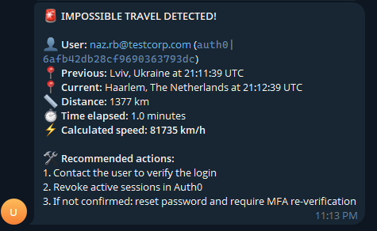

# Auth0 Impossible Travel Security Detector

An automated IAM/SecOps monitoring prototype designed to detect Account Takeover (ATO) attempts by tracking "Impossible Travel" anomalies based on Auth0 login logs and IP geolocation.

## Tech Stack
* Language: Python 3
* IAM Platform: Auth0 Management API (OAuth 2.0, M2M, Principle of Least Privilege)
* APIs & Math: IP Geolocation API, Haversine formula (distance & velocity calculation)
* Alerting: Telegram Bot API

## How It Works
1. Authenticates via OAuth 2.0 Client Credentials flow and fetches recent login logs (`type:s`) from Auth0.
2. Extracts user sessions, timestamps, and IP addresses.
3. Resolves IP coordinates (Latitude/Longitude) via geolocation API.
4. Calculates physical distance and travel velocity between consecutive logins using the Haversine formula.
5. Triggers an instant Telegram security alert if calculated speed exceeds the threshold (`> 800 km/h`).

## Demo Alert


## Setup & Usage
1. Install dependencies:
   ```bash
   pip install -r requirements.txt
2. Set environment variables (`AUTH0_DOMAIN`, `AUTH0_CLIENT_ID`, `AUTH0_CLIENT_SECRET`, `TELEGRAM_BOT_TOKEN`, `TELEGRAM_CHAT_ID`).
3. Run the detector:
   ```bash
   python detector.py
